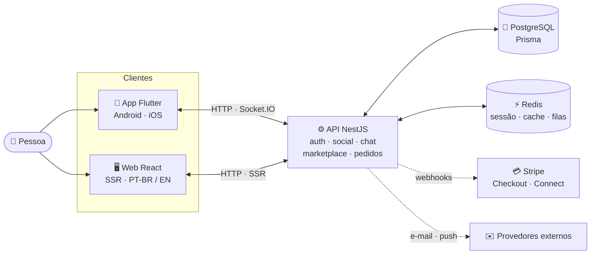
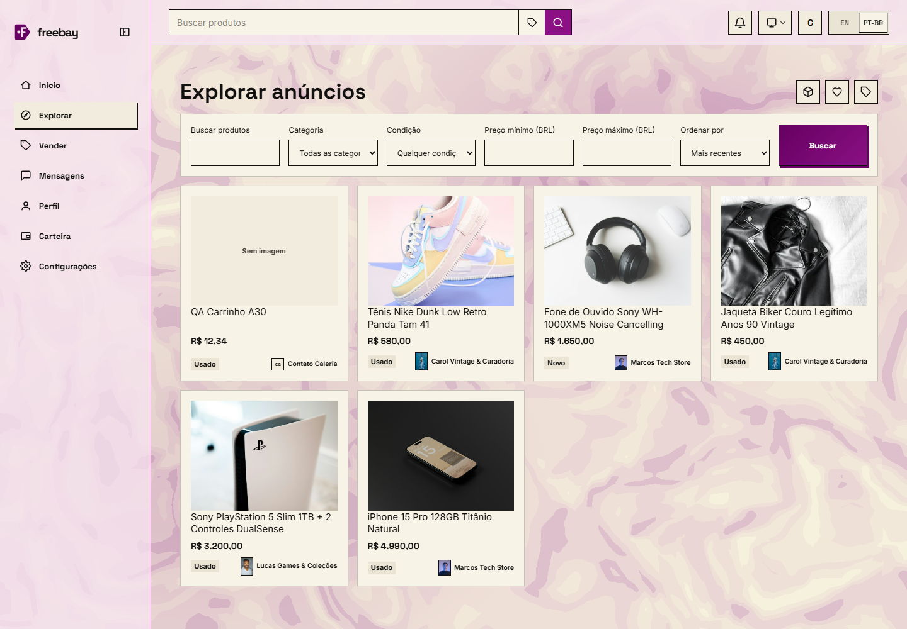
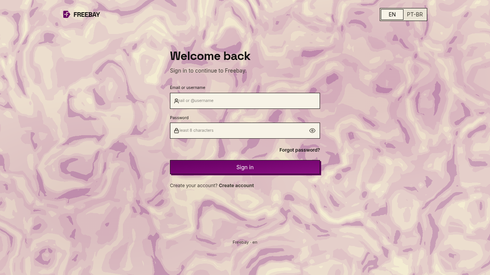

# FreeBay

<p align="center">
  
  
  
  
  
  
</p>

**FreeBay é um marketplace C2C com uma camada social.** Anuncie o que não usa
mais, descubra produtos de pessoas reais, converse pelo chat e combine a entrega
em mãos — com pagamento protegido via Stripe. O app Flutter e o cliente web
compartilham a mesma API NestJS.

## Diagrama

> No preview do editor, os nós são clicáveis e abrem a pasta correspondente.



## Telas

<table>
  <tr>
    <td align="center"><br><sub><b>Explorar</b> · app</sub></td>
    <td align="center"><br><sub><b>Catálogo</b> · web</sub></td>
    <td align="center"><br><sub><b>Perfil</b> · app</sub></td>
  </tr>
  <tr>
    <td align="center"><br><sub><b>Carrinho</b> · app</sub></td>
    <td align="center"><br><sub><b>Login</b> · web</sub></td>
    <td align="center"><br><sub><b>Onboarding</b> · app</sub></td>
  </tr>
</table>

## Stack

Flutter · React Router · NestJS · Prisma/PostgreSQL · Redis · Socket.IO · Stripe

## Rodando localmente

```bash
# API — http://localhost:3000
cd nest-backend
npm ci
cp .env.example .env   # preencha os valores locais
npm run db:sync && npx cross-env NODE_ENV=development npm run db:seed
npm run start:dev
```

```bash
# Web — http://localhost:5173
cd web && npm ci && npm run dev
```

```bash
# App
cd frontend && flutter pub get && flutter run --dart-define=API_BASE_URL=http://127.0.0.1:3000
```

## Documentação

- [`docs/FEATURE_TRUTH.md`](docs/FEATURE_TRUTH.md) — o que está implementado, limites e evidências.
- [`AGENTS.md`](AGENTS.md) — convenções, gates e regras de contribuição.
- [`web/README.md`](web/README.md) — cliente web, SSR, OAuth e variáveis de ambiente.
- [`docs/adr/`](docs/adr/) — decisões de arquitetura e escopo do produto.

## Licença

MIT License.
